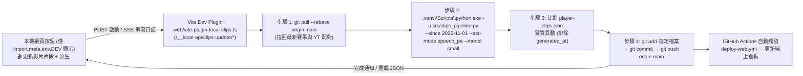

# 本機端網頁一鍵「更新影片片段」實行計畫 (IMPLEMENTATION_PLAN_LOCAL_CLIPS_SYNC.md)

> **建立日期**：2026-11-28  
> **適用環境**：本機 Vite 開發伺服器（`run_web_dev.bat` / `npm run dev`）  
> **核心目標**：於本機端網頁 Header 右側新增「🎬 更新影片片段」按鈕，按下後呼叫本機 `clips_pipeline.py` 產生最新球員影片集合資料，並自動 `git commit` 與 `git push` 至 GitHub 觸發 GitHub Pages 重建，同時確保線上正式建置維持 100% 純靜態與零殘留。

---

## 一、已確認之設計決策

1. **按鈕位置**：僅放置於 Header 右側（`🔄 手動更新` 旁），不在第五頁籤（球員影片集合）額外增設快捷按鈕。
2. **前置同步順序**：按下開始更新且勾選自動推送時，**先執行 `git pull --rebase origin main`**，拉回雲端每日排程同步的最新 `data/pirates.db` 與 YouTube 配對結果後，再執行 `src/clips_pipeline.py`，避免 SQLite 二進位檔合併衝突。
3. **固定核心指令**：
   ```text
   .venv\Scripts\python.exe -u src/clips_pipeline.py --since 2026-11-01 --asr-mode speech_pa --model small
   ```
4. **精準 Git 提交範圍**：僅 `git add` 目標檔案（`data/pirates.db`、`web/public/data/player-clips.json` 及有異動之 `data/player_clip_overrides.csv`），絕不使用 `git add .`。
5. **線上純靜態隔離**：前端透過 `import.meta.env.DEV` 與動態匯入隔離 UI；後端透過 Vite 外掛 `apply: "serve"` 僅在開發伺服器掛載，確保 `npm run build` 產出之 `web/dist/` 完全不含本機 API 與更新按鈕程式碼。

---

## 二、系統資料流與執行步驟



---

## 三、檔案異動清單

| 檔案路徑 | 異動類型 | 職責與內容摘要 |
| :--- | :---: | :--- |
| `web/vite-plugin-local-clips.ts` | 新增 | Vite Dev Server 中介層外掛（`apply: "serve"`）：本機 IP 驗證、參數白名單、單例鎖、4 步驟非同步管線、SSE 即時日誌串流、安全終止子程序（Windows `taskkill /t /f`）。 |
| `web/vite.config.ts` | 修改 | 註冊 `localClipsUpdatePlugin()`。 |
| `web/src/components/local-clips-updater.ts` | 新增 | 原生 `<dialog>` 確認與即時進度視窗（遵循 MWG 1.0 規範），含指令預覽、`--since` 日期調整、自動推送選項、4 步驟進度指示與即時日誌輸出。 |
| `web/src/components/header.ts` | 修改 | 新增 `onOpenLocalClipsUpdater` 與 `setLocalClipsUpdating`，於本機 Header `🔄 手動更新` 旁顯示 `🎬 更新影片片段` 按鈕及執行中狀態提示。 |
| `web/src/main.ts` | 修改 | 僅於 `import.meta.env.DEV` 條件載入 `local-clips-updater`；擴充 `ensureClipsLoaded(true)` 支援完成後強制重載最新 `player-clips.json`。 |
| `web/src/styles/components.css` | 修改 | 加入 MWG `<dialog:modal>` / `::backdrop` 防背景捲動規則，以及更新視窗、步驟條、終端機日誌區與 Header 按鈕執行中樣式。 |

---

## 四、本機 API 規格（`/__local-api/clips-update/*`）

僅允許來自 `127.0.0.1` / `::1` 的連線請求：

1. `GET /__local-api/clips-update/status`：取得目前任務狀態快照、4 步驟狀態與歷史日誌。
2. `GET /__local-api/clips-update/stream`：SSE（`text/event-stream`）串流，連線立即推送 `snapshot`，並持續推送 `state` 與 `log` 事件。
3. `POST /__local-api/clips-update/start`：驗證請求參數白名單（`since` 為 `YYYY-MM-DD`、`asrMode` 預設 `"speech_pa"`、`model` 預設 `"small"`、`autoGitPush` 預設 `true`），透過 `spawn(..., { shell: false })` 依序執行：
   - 步驟 1（`git_pull`）：檢查目標檔案無未解衝突後執行 `git pull --rebase origin main`（若取消勾選自動推送則略過）。
   - 步驟 2（`clips_pipeline`）：以 `PYTHONUTF8=1`、`PYTHONIOENCODING=utf-8` 執行 `src/clips_pipeline.py`。
   - 步驟 3（`check_diff`）：排除 `meta.generated_at` 比對 `web/public/data/player-clips.json` 實質變動，並檢查 `data/player_clip_overrides.csv`；若無實質變動且原工作區乾淨則自動還原僅時間戳變更的檔案並略過提交。
   - 步驟 4（`git_push`）：`git add` 目標檔案 → `git commit -m "chore(clips): 本機更新球員影片片段定位資料"` → `git push origin main`。
4. `POST /__local-api/clips-update/cancel`：中止執行中的子程序樹（Windows 使用 `taskkill /pid <pid> /t /f`）。

---

## 五、驗證與驗收項目

1. `cd web && npm.cmd run typecheck`：`tsc --noEmit` 零錯誤。
2. `cd web && npm.cmd test`：Vitest 單元與對齊測試全數通過。
3. `cd web && npm.cmd run build`：正式建置成功，且確認 `web/dist/` 產物完全不包含 `__local-api` 與「更新影片片段」相關程式碼。
4. `npx.cmd modern-web-guidance@latest legacy-scan ./web/src`：零過時或不合規寫法。
5. 本機 Vite 開發伺服器冒煙測試：確認 `GET /status` 回傳 `200`（`status: "idle"`），且 `POST /start` 傳入非法日期回傳 `400`（不實際觸發耗時轉錄與 `git push`）。
