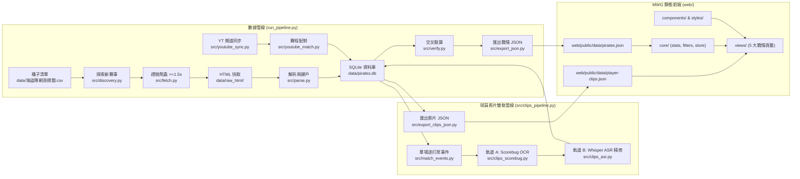

# 台中小海盜棒球數據庫 — 專案程式碼及檔案清單

> **整理時間**：2026-11-28  
> **專案根目錄**：`c:\Users\chinl\OneDrive\文件\就是棒MWG`  
> **技術架構**：Python 3.11+ 數據爬蟲與影片雙軌定位管線 ＋ SQLite ＋ Vite / Vanilla TypeScript / MWG 1.0 靜態前端看板

---

## 一、專案總覽與量化統計

本專案針對「台中就是棒社區棒球聯賽 (2024–2026)」台中小海盜隊（U8 / U10 / U12 / U15）建立端到端數據系統，核心由三大區塊構成：
1. **賽事數據管線（`run_pipeline.py` ＋ `src/`）**：自動探索、禮貌爬取 `myscore.games` 網頁、解析入庫至 SQLite、執行邊界驗算，並匯出純靜態 JSON。
2. **YouTube 比賽影片與球員影片集雙軌引擎（`src/youtube_*.py`、`src/match_events.py`、`src/clips_*.py`）**：同步 YouTube 賽事影片並與賽程配對；結合官網逐打席事件、軌道 A（Scorebug 視覺狀態機 OCR）與軌道 B（`faster-whisper` ASR 語音逐字稿），產出球員打擊／投球／守備時間戳記片段集。
3. **MWG 1.0 靜態戰情看板（`web/`）**：無重型框架（Vanilla TypeScript + Vite），純唯讀載入 `pirates.json` 與 `player-clips.json`，部署於 GitHub Pages。

### 檔案數量與規模摘要

| 分類 | 檔案數 | 行數／容量摘要 | Git 版控狀態 |
| :--- | :---: | :--- | :--- |
| 根目錄文件、管線入口與腳本 | 13 | 1,207 行（約 65.3 KB） | 已追蹤 |
| Python 後端模組（`src/`） | 15 | 8,149 行（約 316.5 KB） | 已追蹤 |
| 自動化測試（`tests/` ＋ `web/src/tests/`） | 2 | 627 行（Python 209L ＋ TypeScript 418L） | 已追蹤 |
| 前端組態、靜態資源與 JSON（`web/` 非 `src/`） | 8 | 1,783 行（不含 `player-clips.json`；`pirates.json` 402 KB、`player-clips.json` 3.65 MB） | 已追蹤（`node_modules/`、`dist/`、`.vite/` 忽略） |
| 前端原始碼（`web/src/`，不含測試） | 21 | 7,769 行（約 222.6 KB） | 已追蹤 |
| CI/CD 與 Google Apps Script（`.github/`、`scripts/gas/`） | 4 | 551 行（約 21.3 KB） | 已追蹤 |
| 納入版控之資料檔（`data/` 核心檔） | 6 | `pirates.db` 4.56 MB ＋ CSV / JSON 約 250 KB | 已追蹤 |
| 本地快取／實驗產物／封存目錄（`data/raw_html` 等、`OLD/`） | 764 | 約 103.65 MB（385 HTML ＋ 358 逐字稿/時間軸 JSON ＋ 18 PoC ＋ 3 舊腳本） | `.gitignore` 忽略 |
| 專案技能定義（`.agents/`） | 212 | 約 2.00 MB（MWG 1.0 指南文件與規格） | 工具技能目錄 |

> 核心列管檔案共 **69** 筆（含根目錄、`.github/`、`scripts/`、`src/`、`tests/`、`data/` 核心資料檔與 `web/` 組態／原始碼）；另有 `764` 筆本地快取／實驗／封存檔案與 `.agents/` 技能庫、`1` 套 `.venv/` 及 `web/node_modules/`。

---

## 二、專案目錄樹結構

```text
就是棒MWG/
├── .agents/                          # [技能庫] Modern Web Guidance (MWG 1.0) 本地參考指南 (212 檔)
├── .github/
│   └── workflows/
│       ├── deploy-web.yml            # GitHub Actions：建置 web/ 並部署至 GitHub Pages
│       └── update-data.yml           # GitHub Actions：每日台灣時間 09:41 自動同步數據並觸發部署
├── .venv/                            # [忽略] Python 3.11+ 本地虛擬環境
├── OLD/                              # [忽略] 封存之 PoC 原型腳本 (3 檔)
│   ├── poc_export_eval.py
│   ├── poc_fetch_and_parse_matches.py
│   └── poc_scorebug_align.py
├── data/
│   ├── pirates.db                    # [版控] SQLite 核心資料庫 (4.78 MB)
│   ├── 海盜隊網頁標題.csv              # [版控] myscore.games 聯賽種子清單 (42L)
│   ├── youtube_videos.json           # [版控] YouTube 頻道「海盜」影片快取清單 (4,373L)
│   ├── youtube_match_mapping_report.csv # [版控] 影片與賽程自動配對報表 (190L)
│   ├── youtube_manual_overrides.csv  # [版控] YouTube 賽程配對人工覆寫表 (1L)
│   ├── player_clip_overrides.csv     # [版控] 球員影片片段時間戳人工覆寫表 (1L)
│   ├── raw_html/                     # [忽略] myscore.games 本地 HTML 快取 (385 檔 / 9.45 MB)
│   ├── transcripts/                  # [忽略] faster-whisper 語音逐字稿快取 (178 檔 / 34.17 MB)
│   ├── video_timelines/              # [忽略] Scorebug 視覺掃描時間軸快取 (180 檔 / 56.13 MB)
│   ├── poc_scorebug/                 # [忽略] Scorebug PoC 實驗輸出 (13 檔 / 7.22 MB)
│   ├── poc_eval/                     # [忽略] 高〇展 PoC 評估報告三件組 (5 檔 / 1.19 MB)
│   └── tmp_poc_videos/               # [忽略] PoC 暫存影片目錄 (空)
├── scripts/
│   └── gas/
│       ├── README.md                 # Google Apps Script 定時觸發設定文件
│       └── trigger_update_data.gs    # GAS 主動呼叫 GitHub workflow_dispatch API 腳本
├── src/                              # Python 後端數據與影片雙軌定位管線 (15 檔)
│   ├── __init__.py
│   ├── seed_loader.py
│   ├── discovery.py
│   ├── fetch.py
│   ├── parse.py
│   ├── db.py
│   ├── verify.py
│   ├── export_json.py
│   ├── youtube_sync.py
│   ├── youtube_match.py
│   ├── match_events.py
│   ├── clips_scorebug.py
│   ├── clips_asr.py
│   ├── clips_pipeline.py
│   └── export_clips_json.py
├── tests/
│   └── test_clips_p1.py              # P1 雙軌對齊演算法單元測試
├── web/                              # 現代靜態前端戰情看板 (Vite + Vanilla TypeScript + MWG 1.0)
│   ├── index.html
│   ├── package.json
│   ├── package-lock.json
│   ├── tsconfig.json
│   ├── vite.config.ts
│   ├── node_modules/                 # [忽略] 前端相依套件
│   ├── dist/                         # [忽略] Vite 正式建置輸出
│   ├── public/
│   │   ├── favicon.svg
│   │   └── data/
│   │       ├── pirates.json          # [版控] 前端戰情數據靜態 JSON (402 KB)
│   │       └── player-clips.json     # [版控] 球員影片集合靜態 JSON (3.65 MB)
│   └── src/
│       ├── main.ts                   # 應用程式進入點、路由與雙資料集載入
│       ├── types/
│       │   └── data.ts               # 前端資料契約與狀態型別定義
│       ├── core/
│       │   ├── stats.ts              # 棒球純函式計算引擎
│       │   ├── filters.ts            # 資料索引、全域篩選與聚合運算引擎
│       │   ├── store.ts              # 全域應用狀態與 URL Query 雙向同步
│       │   └── csv.ts                # 瀏覽器端 UTF-8 BOM CSV 匯出工具
│       ├── components/
│       │   ├── header.ts             # 頂部標題列、主題切換與本地更新捷徑
│       │   ├── filter-bar.ts         # 篩選列與手機原生 <dialog> 抽屜
│       │   ├── tabs.ts               # 無障礙頁籤元件 (5 大頁籤)
│       │   ├── data-table.ts         # 可排序響應式數據表
│       │   ├── player-combobox.ts    # IME 安全球員搜尋選單
│       │   └── charts.ts             # Chart.js 樹搖折線圖封裝
│       ├── views/
│       │   ├── overview.ts           # Tab 1：分隊戰情總覽
│       │   ├── leaderboards.ts       # Tab 2：投打排行榜
│       │   ├── player-profile.ts     # Tab 3：球員跨屆成長檔案
│       │   ├── opponents.ts          # Tab 4：賽程戰果與對手分析
│       │   └── player-clips.ts       # Tab 5：球員影片集合
│       ├── styles/
│       │   ├── tokens.css            # 黑／金／白主題 Design Tokens 與光暗模式
│       │   ├── reset.css             # 輕量現代 CSS Reset
│       │   ├── layout.css            # 頁面骨架與容器響應式佈局
│       │   └── components.css        # 共用互動元件樣式
│       └── tests/
│           └── stats.test.ts         # Vitest 棒球算式與 SQLite Views 基準對齊測試
├── .gitignore                        # Git 忽略規則（含例外保留 pirates.db / JSON / CSV）
├── AGENTS.md                         # 專案規範、爬蟲紅線、棒球數據鐵則與驗證閘道
├── IMPLEMENTATION_PLAN_MWG.md        # MWG 現代前端遷移實行計畫
├── IMPLEMENTATION_PLAN_PLAYER_CLIPS.md # 第五頁籤「球員影片集合」雙軌定位實行計畫
├── README.md                         # 專案說明文件與快速上手指南
├── requirements-crawler.txt          # 後端爬蟲與基礎管線依賴清單
├── requirements-clips.txt            # 球員影片雙軌定位（OpenCV / Whisper / OCR）依賴清單
├── run_pipeline.py                   # 數據管線總入口腳本
├── run_pipeline_parse_only.bat       # Windows 離線解析重構批次腳本
├── run_web_dev.bat                   # Windows 一鍵啟動新版前端預覽腳本
├── skills-lock.json                  # 本地技能鎖定清單 (modern-web-guidance)
├── update_all.bat                    # Windows 一鍵更新當季戰績並推送 GitHub
└── update_full_discovery.bat         # Windows 全面探索新賽事並推送 GitHub
```

---

## 三、分層檔案與程式碼詳細清單

### 1. 根目錄文件、依賴與 Windows 批次腳本

| 檔案路徑 | 行數 / 大小 | 職責說明 | 核心函式 / 內容摘要 |
| :--- | :---: | :--- | :--- |
| `run_pipeline.py` | 167L / 7.1 KB | 數據管線總入口（探索 → 下載 → 解析 → YT 配對 → 驗算 → JSON 匯出），支援 `--discover`、`--auto-current`、`--parse-only`、`--force`、`--yt-full`、`--skip-youtube` | `resolve_current_year_season()`, `run_pipeline()`, `main()` |
| `README.md` | 117L / 6.8 KB | 專案導覽、快速上手指令、結構說明與 GitHub Actions / Pages 部署說明 | — |
| `AGENTS.md` | 33L / 3.5 KB | 專案規範（語言與環境、爬蟲紅線、棒球數據模型鐵則、MWG 開發規範、強制驗證閘道） | — |
| `IMPLEMENTATION_PLAN_MWG.md` | 379L / 19.4 KB | MWG 1.0 現代前端遷移架構設計與實行計畫 | — |
| `IMPLEMENTATION_PLAN_PLAYER_CLIPS.md` | 274L / 22.1 KB | 第五頁籤「球員影片集合」雙軌定位演算法設計與 PoC 驗證紀錄 | — |
| `requirements-crawler.txt` | 5L / 84 B | 爬蟲與管線 Python 套件鎖定（`httpx`、`beautifulsoup4`、`lxml`、`tenacity`、`yt-dlp`） | — |
| `requirements-clips.txt` | 11L / 512 B | 影片雙軌引擎 Python 套件（`yt-dlp`、`opencv-python-headless`、`faster-whisper`、`pypinyin`、`winrt-*` Windows OCR） | — |
| `.gitignore` | 51L / 1.0 KB | 忽略 `.venv`、`raw_html`、`transcripts`、`video_timelines`、`node_modules`、`OLD` 等，並例外保留 `pirates.db`、JSON 與覆寫 CSV | — |
| `skills-lock.json` | 12L / 362 B | `GoogleChrome/modern-web-guidance` 技能版本鎖定檔 | — |
| `run_web_dev.bat` | 28L / 803 B | Windows 一鍵啟動 `web/` Vite 開發伺服器並自動開啟瀏覽器（首次自動 `npm install`） | `npm.cmd run dev -- --open` |
| `update_all.bat` | 63L / 1.6 KB | Windows 一鍵執行 `--auto-current` 管線、Git 提交、`pull --rebase` 並推送 `main` | `run_pipeline.py --auto-current` |
| `update_full_discovery.bat` | 52L / 1.5 KB | Windows 一鍵執行全聯賽探索與 2026 年度刷新並推送 `main` | `run_pipeline.py --discover --refresh-year 2026` |
| `run_pipeline_parse_only.bat` | 15L / 528 B | Windows 離線重跑快取解析管線腳本 | `run_pipeline.py --parse-only`（含路徑提醒，見第五節） |

---

### 2. Python 後端核心數據管線（`src/`）

| 檔案路徑 | 行數 / 大小 | 職責說明 | 核心函式 / 類別 / 匯出 |
| :--- | :---: | :--- | :--- |
| `src/__init__.py` | 1L / 49 B | `src` Python 套件標記檔 | — |
| `src/seed_loader.py` | 134L / 3.9 KB | 讀取並解析 `data/海盜隊網頁標題.csv`，擷取年度、賽季、盃賽類型、年齡組別與隊伍分組 | `extract_league_meta()`, `classify_team_group()`, `load_seeds()` |
| `src/discovery.py` | 234L / 9.1 KB | 連線探索 `myscore.games` 新屆賽事連結，過濾並增量更新種子 CSV | `clean_link_text()`, `extract_links_from_html()`, `fetch_page()`, `extract_titles_from_html()`, `get_existing_urls()`, `discover_pirate_links()` |
| `src/fetch.py` | 166L / 5.6 KB | 禮貌網頁爬蟲，落實單線程循序請求、`>= 1.5` 秒間隔與本地 `data/raw_html/` 快取 | `fetch_url()`, `fetch_and_cache()`, `fetch_all()`, `main()` |
| `src/parse.py` | 888L / 29.8 KB | 離線讀取 `data/raw_html/` 解析教練、名單、賽程、打擊／投球數據、盜壘榜，並以 `player_uid` 跨屆歸戶與轉換出局數整數 | `parse_coaches()`, `parse_roster()`, `parse_matches()`, `resolve_player()`, `parse_batting_stats()`, `parse_pitching_stats()`, `parse_top10_sb()`, `parse_and_store_team()`, `parse_all()`, `main()` |
| `src/db.py` | 347L / 15.6 KB | 初始化 SQLite Schema（開啟 `PRAGMA foreign_keys = ON`）與生涯統計 Views，含賽程、影片與球員片段資料表 | `get_db_connection()`, `init_db()` |
| `src/verify.py` | 447L / 19.5 KB | 自動化交叉驗算（同名球員隔離、出局數轉換、0 局責失保留、海盜內戰視角、外鍵與教練拋打排除等） | `VerificationRunner`, `main()` |
| `src/export_json.py` | 360L / 12.8 KB | 以唯讀連線讀取 `data/pirates.db`，預判 `pirate_side` 並匯出 `web/public/data/pirates.json`（含 SQLite Views 基準檢核用資料） | `get_readonly_connection()`, `resolve_pirate_side()`, `build_dataset()`, `export_json()`, `main()` |

---

### 3. YouTube 影片同步與球員影片集雙軌引擎（`src/`）

| 檔案路徑 | 行數 / 大小 | 職責說明 | 核心函式 / 類別 / 匯出 |
| :--- | :---: | :--- | :--- |
| `src/youtube_sync.py` | 729L / 27.4 KB | 掃描並同步兩個 YouTube 頻道中的「海盜」比賽影片中繼資料至 `data/youtube_videos.json` | `normalize_text()`, `contains_pirates()`, `extract_part_label()`, `is_obvious_non_match_title()`, `classify_match_video()`, `fetch_watch_metadata()`, `fetch_video_metadata_ytdlp()`, `list_channel_pirate_entries()`, `list_channel_search_pirate_entries()`, `load_youtube_cache()`, `save_youtube_cache()`, `sync_youtube_videos()`, `main()` |
| `src/youtube_match.py` | 835L / 31.5 KB | 將 YouTube 影片標題與 `matches` 賽程表進行多維度評分對齊，支援人工覆寫 CSV 並產出配對報表 | `MatchEvent`, `normalize_team_name()`, `strip_team_suffix()`, `extract_pirate_color()`, `extract_pirate_subtag()`, `parse_video_title()`, `score_video_against_event()`, `load_match_events()`, `ensure_overrides_template()`, `load_manual_overrides()`, `match_and_store_videos()`, `main()` |
| `src/match_events.py` | 883L / 35.9 KB | 下載並解析 `myscore.games` 單場攻守表（`show_record.php`）與逐打席文字紀錄（`show_text.php`），萃取全員打擊／投球／守備事件清單 | `extract_site_match_id()`, `clean_text()`, `normalize_team_name()`, `split_jersey_and_name()`, `parse_show_record_html()`, `summarize_pa_result()`, `parse_show_text_html()`, `extract_all_players_involvement()`, `fetch_and_parse_matches()`, `main()` |
| `src/clips_scorebug.py` | 1,171L / 46.6 KB | **軌道 A（視覺狀態機）**：對比賽影片進行記分板（黑底白框 / MEVO 深綠底）OCR 掃描、平滑清理時間軸，並對齊半局與出局錨點 | `ScorebugOCR`, `download_temp_video()`, `clean_scorebug_timeline()`, `store_scorebug_segments_to_db()`, `align_game_all_players()` |
| `src/clips_asr.py` | 1,456L / 59.3 KB | **軌道 B（語音精修）**：以 `faster-whisper` 產出時間戳逐字稿（本地遮罩個資）、結合拼音／姓名比對對片段開始秒數做精修與信心度校準 | `build_player_matcher()`, `mask_matched_names_in_text()`, `download_temp_audio()`, `refine_clips_with_asr()` |
| `src/clips_pipeline.py` | 265L / 10.3 KB | 雙軌球員影片集合整合執行入口：串接單場事件、軌道 A/B 對齊、人工覆寫表 `player_clip_overrides.csv` 與 DB 入庫 | `ensure_overrides_template()`, `apply_manual_overrides()`, `store_player_clips_to_db()`, `main()` |
| `src/export_clips_json.py` | 233L / 9.1 KB | 從 SQLite 匯出第五頁籤所需靜態資料集至 `web/public/data/player-clips.json` | `fmt_mmss()`, `build_clips_dataset()`, `export_clips_json()`, `main()` |

---

### 4. 前端戰情看板（`web/`，Vite + Vanilla TypeScript + MWG 1.0）

#### 4.1 組態、HTML 殼層與靜態資源

| 檔案路徑 | 行數 / 大小 | 職責說明 | 重點設定／摘要 |
| :--- | :---: | :--- | :--- |
| `web/index.html` | 28L / 1.1 KB | SPA 單頁入口 HTML（`lang="zh-Hant"`、響應式 viewport、掛載 `#app`） | 載入 `/src/main.ts` |
| `web/package.json` | 23L / 462 B | 前端依賴與指令定義（`chart.js`、`vite`、`vitest`、`typescript`） | `dev`、`build`、`preview`、`typecheck`、`test` |
| `web/package-lock.json` | 1,694L / 52.8 KB | npm 相依樹鎖定檔 | — |
| `web/tsconfig.json` | 18L / 452 B | TypeScript 編譯設定（ES2022、`bundler` 解析、嚴格型別檢查） | — |
| `web/vite.config.ts` | 13L / 234 B | Vite 與 Vitest 合併組態，`base: "./"` 相容 GitHub Pages 子路徑部署 | `defineConfig` |
| `web/public/favicon.svg` | 6L / 499 B | 頁面向量圖示 | — |
| `web/public/data/pirates.json` | 1L / 402 KB | 靜態賽事、隊伍、球員與 SQLite Views 校驗基準資料（由 `export_json.py` 生成） | 單行壓縮 JSON |
| `web/public/data/player-clips.json` | — / 3.65 MB | 靜態球員影片集合（打席／投球／守備時間戳片段，由 `export_clips_json.py` 生成） | 壓縮 JSON |

#### 4.2 應用程式入口、型別與核心計算引擎（`web/src/`）

| 檔案路徑 | 行數 / 大小 | 職責說明 | 核心函式 / 類別 / 匯出 |
| :--- | :---: | :--- | :--- |
| `web/src/main.ts` | 363L / 11.5 KB | 前端進入點：載入靜態 JSON、初始化 `AppStore`、組裝 Header / FilterBar / Tabs 與五大視圖、處理路由與主題套用 | — |
| `web/src/types/data.ts` | 434L / 9.9 KB | 全域資料契約（`Dataset`、`PlayerClipsDataset`、`Filters`、`AppState`、榜單與事件型別定義），定義 `COACH_PITCH_UID` 等常數 | `COACH_PITCH_UID`, `AgeGroup`, `TeamGroup`, `TabId`, `PlayerClipItem`, `PlayerClipsRecord` 等共 37 個型別／常數 |
| `web/src/core/stats.ts` | 149L / 3.9 KB | 棒球純函式計算引擎（AVG / OBP / SLG / OPS / ERA / WHIP / K7 / 局數格式化與 0 局防呆） | `roundTo`, `calcTotalBases`, `calcAvg`, `calcObp`, `calcSlg`, `calcOps`, `formatInnings`, `calcEra`, `calcWhip`, `calcK7`, `calcWinRate`, `formatRate3`, `formatRate2` |
| `web/src/core/filters.ts` | 1,027L / 27.4 KB | 資料索引建立、多維度篩選、海盜內戰勝負視角計算、總覽／排行榜／球員歷屆／對手統計聚合引擎 | `DatasetIndex`, `createDatasetIndex`, `getFilteredTeamIds`, `evaluateMatchResult`, `computeOverview`, `computeBattingLeaderboard`, `computePitchingLeaderboard`, `computeOpponents`, `getSelectablePlayers`, `PlayerSeasonBattingRow`, `PlayerSeasonPitchingRow`, `PlayerHistorySummary`, `getPlayerHistory` |
| `web/src/core/store.ts` | 297L / 8.5 KB | 全域狀態管理器，與 URL Query String 雙向同步（支援分享連結 `?tab=...&uid=...`） | `createDefaultFilters`, `resolveDefaultPlayerUid`, `createDefaultState`, `parseStateFromSearch`, `serializeStateToSearch`, `StateListener`, `AppStore` |
| `web/src/core/csv.ts` | 53L / 1.6 KB | 瀏覽器端 UTF-8 BOM（`\uFEFF`）CSV 產生與下載工具 | `escapeCsvCell`, `buildCsvContent`, `downloadCsv` |

#### 4.3 共用 UI 元件（`web/src/components/`）

| 檔案路徑 | 行數 / 大小 | 職責說明 | 核心匯出 |
| :--- | :---: | :--- | :--- |
| `web/src/components/header.ts` | 264L / 8.1 KB | 頂部標題列、系統時間戳格式化（台北時區）、亮／暗模式切換與本地開發限定「手動更新」捷徑 | `ResolvedTheme`, `HeaderOptions`, `HeaderController`, `formatTaipeiTimestamp`, `createHeader` |
| `web/src/components/filter-bar.ts` | 390L / 12.4 KB | 桌面篩選控制列與手機原生 `<dialog>` 抽屜篩選器，支援已啟用篩選群組計數 | `FilterBarOptions`, `FilterBarController`, `countActiveFilterGroups`, `createFilterBar` |
| `web/src/components/tabs.ts` | 170L / 5.0 KB | 遵循 WAI-ARIA Tabs 鍵盤操作規範的五大主頁籤切換元件 | `TabDefinition`, `MAIN_TABS`, `TabsOptions`, `TabsController`, `createTabs` |
| `web/src/components/data-table.ts` | 321L / 9.5 KB | 可排序、具響應式橫向捲動與凍結欄支援之通用數據表元件 | `SortDirection`, `TableColumn`, `DataTableOptions`, `DataTableController`, `createDataTable` |
| `web/src/components/player-combobox.ts` | 312L / 9.0 KB | 無障礙球員搜尋 Combobox，內建中文注音 IME `compositionstart/end` 防誤觸與跨屆同名標籤顯示 | `PlayerComboboxOptions`, `PlayerComboboxController`, `formatPlayerOptionLabel`, `createPlayerCombobox` |
| `web/src/components/charts.ts` | 225L / 5.8 KB | Chart.js 精簡樹搖封裝元件（響應主題 Token 色彩之歷屆成長折線圖） | `TrendSeries`, `TrendChartConfig`, `TrendChartController`, `createTrendChart` |

#### 4.4 頁面視圖與樣式系統（`web/src/views/`、`web/src/styles/`）

| 檔案路徑 | 行數 / 大小 | 職責說明 | 核心匯出 / 內容摘要 |
| :--- | :---: | :--- | :--- |
| `web/src/views/overview.ts` | 219L / 5.5 KB | Tab 1：分隊戰情總覽（KPI 卡片、勝率與隊伍成績摘要表） | `OverviewViewController`, `createOverviewView` |
| `web/src/views/leaderboards.ts` | 623L / 21.0 KB | Tab 2：投打排行榜（打擊／投球切換、門檻滑桿、ERA 局數切換、排除教練拋打、CSV 匯出） | `LeaderboardsViewOptions`, `LeaderboardsViewController`, `createLeaderboardsView` |
| `web/src/views/player-profile.ts` | 511L / 20.0 KB | Tab 3：球員跨屆成長檔案（生涯數據卡、歷屆趨勢圖、逐屆打擊／投球明細表與 CSV 匯出） | `PlayerProfileViewOptions`, `PlayerProfileViewController`, `createPlayerProfileView` |
| `web/src/views/opponents.ts` | 304L / 9.0 KB | Tab 4：賽程戰果與對手分析（對戰戰績統計、逐場比分表與比賽 YouTube 連結） | `OpponentsViewOptions`, `OpponentsViewController`, `createOpponentsView` |
| `web/src/views/player-clips.ts` | 662L / 22.7 KB | Tab 5：球員影片集合（依 `player_uid` 檢視每場打席／投球／守備 YouTube 秒數跳轉連結與信心度篩選） | `PlayerClipsViewOptions`, `PlayerClipsViewState`, `PlayerClipsViewController`, `createPlayerClipsView` |
| `web/src/styles/tokens.css` | 214L / 7.6 KB | 黑／金／白主題 Design Tokens、字體尺規與亮／暗模式變數定義 | CSS Custom Properties |
| `web/src/styles/reset.css` | 113L / 1.8 KB | 輕量現代 CSS Reset 與安全盒模型設定 | — |
| `web/src/styles/layout.css` | 170L / 3.1 KB | 頁面骨架、Header、容器寬度與響應式格線佈局 | — |
| `web/src/styles/components.css` | 948L / 19.4 KB | 互動元件樣式（最小點擊熱區、焦點外框、`<dialog>` 抽屜、數據表、頁籤與卡片） | — |

---

### 5. 自動化測試（`tests/`、`web/src/tests/`）

| 檔案路徑 | 行數 / 大小 | 職責說明 | 核心測試內容 |
| :--- | :---: | :--- | :--- |
| `tests/test_clips_p1.py` | 209L / 8.9 KB | Python P1 雙軌對齊演算法單元測試 | `TestClipsP1`（驗證 Scorebug 時間軸、半局對齊與事件匹配） |
| `web/src/tests/stats.test.ts` | 418L / 17.1 KB | Vitest 前端棒球算式與 SQLite Views 基準對齊測試 | 驗證 `stats.ts`、`filters.ts`、`store.ts` 與 `pirates.json` 內 SQLite Views 基準值完全一致 |

---

### 6. CI/CD 與外部自動化觸發（`.github/`、`scripts/`）

| 檔案路徑 | 行數 / 大小 | 職責說明 | 觸發條件與動作 |
| :--- | :---: | :--- | :--- |
| `.github/workflows/deploy-web.yml` | 77L / 1.7 KB | GitHub Pages 前端部署工作流程 | `web/**` 異動推送或由 `update-data.yml` 呼叫；執行 `typecheck`、`test`、`build` 並部署至 Pages |
| `.github/workflows/update-data.yml` | 191L / 7.0 KB | 每日自動同步賽事數據管線工作流程 | 每日 UTC 01:41（台灣 09:41）排程或手動 `workflow_dispatch`；快取 `raw_html/`、跑管線、有異動才提交並觸發部署 |
| `scripts/gas/README.md` | 77L / 5.2 KB | Google Apps Script 每日定時觸發設定教學 | 說明如何設定 GAS 定時呼叫 GitHub REST API 補強排程延遲 |
| `scripts/gas/trigger_update_data.gs` | 206L / 7.5 KB | Google Apps Script 定時觸發腳本 | 主動呼叫 GitHub `update-data.yml` 之 `workflow_dispatch` API |

---

### 7. 資料檔、本地快取與封存目錄（`data/`、`OLD/`）

#### 7.1 納入 Git 版控之資料檔

| 檔案路徑 | 行數 / 大小 | 職責說明 |
| :--- | :---: | :--- |
| `data/pirates.db` | — / 4.56 MB | 核心 SQLite 資料庫（儲存隊伍、球員、教練、賽程、攻守統計、YouTube 影片與球員片段） |
| `data/海盜隊網頁標題.csv` | 42L / 8.5 KB | `myscore.games` 歷屆台中小海盜各組別網址種子清單（UTF-8-SIG） |
| `data/youtube_videos.json` | 4,373L / 166.5 KB | YouTube 兩頻道含「海盜」字樣影片之快取中繼資料 |
| `data/youtube_match_mapping_report.csv` | 190L / 75.2 KB | YouTube 比賽影片與官網賽程自動配對結果及信心評分報表 |
| `data/youtube_manual_overrides.csv` | 1L / 44 B | YouTube 比賽配對人工覆寫規則表（標題列範本） |
| `data/player_clip_overrides.csv` | 1L / 87 B | 球員影片集合時間戳人工覆寫表（標題列範本） |

#### 7.2 `.gitignore` 忽略之本地快取、實驗產物與封存目錄

| 目錄／檔案 | 檔案數 / 占用容量 | 說明 |
| :--- | :---: | :--- |
| `data/raw_html/` | 385 檔 / 9.45 MB | `myscore.games` 原始下載網頁快取（離線重跑 `parse.py` 專用） |
| `data/transcripts/` | 178 檔 / 34.17 MB | `faster-whisper` ASR 語音含時間戳記逐字稿快取 |
| `data/video_timelines/` | 180 檔 / 56.13 MB | 軌道 A Scorebug 視覺狀態機逐秒掃描結果快取 |
| `data/poc_scorebug/` | 13 檔 / 7.22 MB | Scorebug 實驗掃描輸出 JSON |
| `data/poc_eval/` | 5 檔 / 1.19 MB | `高〇展_2015-10` 評估資料三件組（`.json` / `.csv` / `_report.md`） |
| `data/tmp_poc_videos/` | 0 檔 / 0 MB | PoC 暫存影片下載目錄 |
| `OLD/` | 3 檔 / 88.9 KB | 封存之早期 PoC 腳本：`poc_fetch_and_parse_matches.py` (830L)、`poc_scorebug_align.py` (1,020L)、`poc_export_eval.py` (378L) |
| `.agents/` | 212 檔 / 2.00 MB | Modern Web Guidance (MWG 1.0) 本地技能文件庫 |

---

## 四、系統資料流與模組相依架構圖



---

## 五、專案維護備註（盤點過程觀察）

1. **`run_pipeline_parse_only.bat` 路徑硬編碼**：該檔第 4 行為 `cd /d "C:\Users\chinl\OneDrive\文件\就是棒"`，與目前專案目錄 `就是棒MWG` 不同；若雙擊執行可能會切換至舊目錄，建議日後改為 `cd /d "%~dp0"`（與 `run_web_dev.bat` 一致）。
2. **`update_full_discovery.bat` 結尾提示訊息**：第 48–49 行仍顯示舊版 Streamlit Cloud 網址，與 `update_all.bat` 顯示的新版 GitHub Pages 網址不同。
